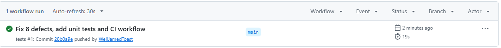

# Defects found and fixed

| # | Where | What could go wrong | Fix | Test(s) |
|---|-------|---------------------|-----|---------|
| 1 | `cart.py` `apply_discount` / `total` | The discounted total was calculated once, when the code was applied, and stored. If the user then edited the cart, the stored total was still charged. Applying a code twice also compounded (10% off an already-discounted total). | Only the discount code is stored. `total()` always recalculates from the current subtotal, so edits are reflected and codes can't compound. | `test_discount_recalculates_after_cart_is_edited`, `test_applying_discount_twice_does_not_compound` |
| 2 | `cart.py` `add_item` | The stock check compared only the quantity being added, not the quantity already in the cart. Adding 3 + 3 laptops succeeded with stock of 5. | Check `already_in_cart + quantity` against stock. | `test_combined_quantity_cannot_exceed_stock` |
| 3 | `cart.py` `load` | `load()` appended to the existing lines, so loading twice doubled every quantity. | Reset `self.lines` before loading. | `test_repeated_load_does_not_duplicate_quantities` |
| 4 | `repository.py` `get_product`, `get_saved_cart` | SQL injection: user input was formatted into SQL with f-strings. `"' OR '1'='1"` returned another product / another user's saved cart. | Parameterized queries with `?` placeholders. | `test_get_product_is_not_vulnerable_to_sql_injection`, `test_get_saved_cart_is_not_vulnerable_to_sql_injection` |
| 5 | `checkout.py` | Stock was decremented **before** payment and never restored, so a declined or failed payment still consumed inventory. | Stock is reserved before charging. If the payment is declined or errors, `release_stock_and_mark_order()` gives it back in the same transaction that records the status. | `test_declined_payment_restores_stock_and_keeps_cart`, `test_gateway_exception_restores_stock_and_keeps_cart` |
| 6 | `checkout.py`, `repository.py` `update_stock` | Stock was not re-checked at checkout and `update_stock` had no guard. If stock changed after an item was added, the order still went through and stock went negative (overselling). Multi-item decrements weren't atomic. | `reserve_stock_and_create_order()` uses `UPDATE ... WHERE stock >= ?` for each line inside one transaction (all-or-nothing). Schema adds `CHECK (stock >= 0)`. Returns status `out_of_stock` without charging. | `test_stock_changed_after_adding_to_cart_is_not_charged`, `test_stock_reservation_is_all_or_nothing` |
| 7 | `checkout.py` | The cart and saved cart were cleared even when the payment was declined or errored, so the customer lost the cart. | Cart is cleared only after an approved payment. | `test_declined_payment_restores_stock_and_keeps_cart` |
| 8 | `checkout.py`, schema | No duplicate-request protection: `request_id` was stored but never checked, so a double-click or retry charged twice and created two orders. | `request_id` is required and `UNIQUE`. A repeated `request_id` returns the original order without charging. The pending order is inserted in the same transaction as the stock reservation, so two simultaneous requests can't both succeed. | `test_repeated_checkout_with_same_request_id_charges_once` |

## Assumptions

- **One discount code at a time.** Applying a new valid code replaces the old one.
- **`request_id` identifies one checkout attempt.** Re-submitting it returns the original result, whatever the outcome. To retry after a decline, the client sends a new `request_id`.
- **`payment_error` is treated as "not charged":** stock is released and the cart is kept.
- **Schema change:** `request_id` is now `NOT NULL UNIQUE` and stock has `CHECK (stock >= 0)`. Delete any old `shop.db` before running `setup_db.py`.

## Test results

```
$ python -m pytest -q
..............                                                           [100%]
14 passed in 0.17s
```

12 new unit tests (`test_cart.py`, `test_repository.py`, `test_checkout.py`) plus the 2 starter smoke tests. Each test uses a temporary SQLite database (`tmp_path`) and a fake payment gateway, so the suite is deterministic. Run against the original starter code, 11 of the 14 fail.

## CI

GitHub Actions workflow: `.github/workflows/tests.yml` (runs on every push and pull request).

Successful run: 
